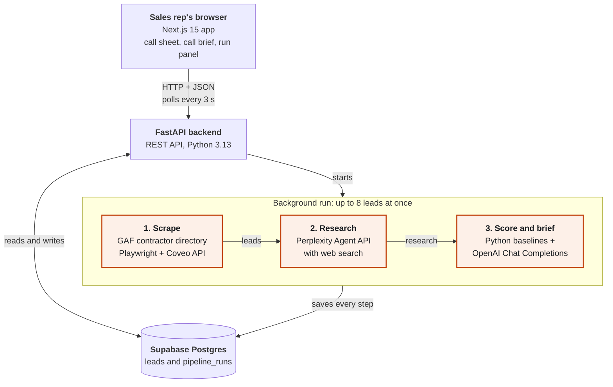

<h1 align="center">GAF - Cosailor</h1>

<p align="center"><i>Know who to call first, and walk into the call prepared.</i></p>

<p align="center">
  <a href="https://github.com/Yash-Bobde/gaf-cosailor/actions/workflows/ci.yml"></a>
  
  
  
  
  
  
</p>

<p align="center">
  <b>Cosailor turns the public GAF contractor directory into a ranked, researched call sheet,<br>
  so a roofing distributor's sales reps know who to call first, why, what to say and who to ask for.</b>
</p>

<p align="center">
  <a href="#why-cosailor">Why</a> ·
  <a href="#architecture">Architecture</a> ·
  <a href="#how-it-works">How it works</a> ·
  <a href="#how-leads-are-ranked">Ranking</a> ·
  <a href="#getting-started">Getting started</a> ·
  <a href="#api-reference">API</a> ·
  <a href="#testing-and-quality">Testing</a> ·
  <a href="#future-enhancements">Roadmap</a>
</p>

---

## Why Cosailor

The GAF directory lists dozens of certified roofing contractors within 25 miles of any ZIP code.
It tells a rep who exists. It doesn't tell them who is worth calling today, or what to say when
someone picks up.

Cosailor does that homework before the call. Pick a ZIP code and a radius, click
**Build call list**, and within a minute a ranked call sheet of ten contractors is ready.

| A rep's question | Cosailor's answer |
|---|---|
| **Who should I call first?** | A priority score and a clear label: *Call first*, *This week* or *Nurture* |
| **Why them?** | Fit and Opportunity scores, each with a one-line reason, plus a "Why this rank?" breakdown |
| **What do I say?** | A short summary, three talking points about that contractor and a recommended approach |
| **Who do I ask for?** | People named in the research, labelled *Decision-maker* or *Contact*, with the sentence and source that name them |

The default search matches the case study: **residential contractors within 25 miles of ZIP 10013**.

---

## What a rep gets

**The call sheet** (`/`)
- Contractors ranked by priority and labelled **Call first**, **This week** or **Nurture**.
- A roofline icon whose pitch rises with priority, so the order is clear at a glance.
- Click-to-call on every row. Filter by Fit and segment. Sort by priority, newest or A–Z.
- Leads appear one by one while a run is in progress.

**The call brief** (`/leads/{id}`)
- A summary, three talking points and a recommended approach, all about that contractor.
- **Who to ask for:** each person is labelled *Decision-maker* or *Contact* and shown with the
  research sentence that names them, plus a link to the source.
- Every source the research cited, the full research notes, both scores with their reasons and a
  "Why this rank?" breakdown that shows the arithmetic.
- One-tap **Call**, the contractor's website and **View GAF profile**.

**The run panel**
- ZIP code, radius (25, 50 or 100 miles), segment (residential or commercial) and max leads.
- Live progress (found, scored, needs retry) and a **Cancel** button.
- A clear summary when the run ends, such as "Last run scored 8 of 9 contractors."

---

## Architecture



| Layer | Built with | What it does |
|---|---|---|
| **Frontend** | Next.js 15 (App Router), React 19, TypeScript, Tailwind CSS 4 | Call sheet, call brief and run panel. Pages render on the server, and the run panel polls for progress every 3 seconds |
| **API** | FastAPI, Pydantic v2, Python 3.13 | REST endpoints, input validation, starting and cancelling runs |
| **Pipeline** | `asyncio`, `PipelineService` | Scrape, then research and score each lead, with up to 8 leads in flight |
| **Scraping** | Playwright (headless Chromium), `httpx` | Opens the GAF locator once, captures its Coveo search token and fetches the remaining pages directly |
| **Research** | Perplexity Agent API (`fast` preset, which replaces Sonar) | Public facts and people for each contractor, with citation URLs |
| **Scoring and brief** | Python scoring engine, OpenAI Chat Completions (JSON mode) | Score baselines, ±1 adjustment, talking points and grounded people |
| **Data** | Supabase Postgres | `leads` and `pipeline_runs`. A unique index allows one active run at a time |
| **Quality** | pytest, Vitest, Testing Library, Playwright, GitHub Actions | 252 automated tests, run by CI on every push and pull request |

**Design principles**

- **Python decides, the model adds context.** Scores start from deterministic Python baselines.
  The model can move each one by one point at most, so rankings stay stable and explainable.
- **Save as you go.** Each lead is saved the moment its research or brief is ready, so the call
  sheet fills in live and nothing finished is ever lost.
- **The database holds the truth.** Run status, progress counts and the cancel flag live in
  Postgres. The UI reads them, and the database enforces the rules.
- **Clean layers.** Routers call services, and services call a repository. Dependencies are
  injected, so every layer is tested without a network, a database or an API key.

---

## How it works

### The pipeline, step by step

1. **Scrape.** GAF's contractor locator is a React app whose data comes from a Coveo search API.
   Headless Chromium loads the page once and captures the search token and first results that
   GAF's own page requests. The remaining pages come straight from the Coveo API over HTTP, 100
   at a time. The search URL is built in one place, `build_search_url()`.
2. **Save.** Contractors are upserted on `gaf_contractor_id`. Leads that were already
   researched or scored keep their work, so running the same territory again costs nothing for
   leads that are done.
3. **Research.** Each lead gets one Perplexity Agent API call, which searches the web and then
   answers. It asks for brands used, company size, reputation, growth signals and the people who
   make purchasing decisions. Perplexity's numbered citation markers are turned into inline links
   to the pages it cited, and those pages are kept as sources. The research is saved before the
   next step.
4. **Score and brief.** Python computes the Fit and Opportunity baselines. The model reads the
   GAF data, the research and those baselines, then writes the summary, talking points,
   approach and people as JSON. Code clamps the scores, checks every person against the
   research and works out the priority and tier.

### Trust built in

| Guardrail | How it works |
|---|---|
| **Scores stay anchored** | The model can move each Python baseline by ±1 at most. Values outside that range are clamped, and unreadable ones fall back to the baseline |
| **People are checked against the research** | A person is kept only if their **full name** appears as whole words in the research. Initials and phrases like "Sales Team" don't count |
| **Titles need support** | A title is kept only if the research states it next to the name. *Decision-maker* requires a supported leadership or purchasing title. Everyone else is a *Contact* |
| **Sources are real** | Source links must be pages Perplexity actually cited in its research |
| **Nothing is invented** | If research doesn't come back, no brief is written. The lead shows *Needs retry* and is picked up on the next run |

### Built to keep going

- **Saves every step.** Research and briefs are written to the database as soon as they're ready.
- **Never pays twice.** Saved research is reused on the next run, so a retry skips straight to
  scoring.
- **Each lead runs on its own.** Every lead has its own 240-second budget. One slow contractor
  never holds up the rest of the batch.
- **Smart retries.** Rate limits, server errors and network blips are retried with exponential
  backoff. Permanent errors, such as an invalid key, stop at once instead of wasting time.
- **Safe cancel.** Cancel stops new leads from starting, and leads already in progress finish
  and are saved. A cancelled run is never recorded as completed.
- **One run at a time.** The database allows only one active run. A second click gets
  **409** with the active `run_id`, and the UI attaches to that run instead of starting a
  duplicate.
- **Clear outcomes.** Every run ends *completed*, *cancelled* or *failed*, with a plain-language
  message. "No contractors" is reported only when GAF itself returns zero results.
- **Picks up after a restart.** On startup, runs left open by a stopped server are closed out.
  The next run continues from the saved work.

---

## How leads are ranked

Every lead gets two scores from 1 to 10, combined into one **priority**.

**Priority = (Fit + Opportunity) ÷ 2 × distance factor**

<table>
<tr><th>Fit: how strong a contractor is</th><th>Opportunity: how much there is to win</th></tr>
<tr><td valign="top">

| Signal | Weight | Points |
|---|---|---|
| GAF certification | 40 % | Master Elite 10, Certified 7, none 2 |
| Company size | 25 % | Neutral 5, since GAF doesn't list size. The model's ±1 adjustment draws on the research |
| Star rating | 25 % | Rating × 2 |
| Review count | 10 % | 50 or more reviews scores 10 |

</td><td valign="top">

| Signal in the research | Weight |
|---|---|
| **Portfolio gap:** uses a competitor brand (Owens Corning, CertainTeed, IKO, TAMKO, Atlas, Malarkey) and isn't GAF-exclusive | 40 % |
| **Growth:** hiring, expanding, a new location or market | 35 % |
| **Certification momentum:** recently became GAF certified | 25 % |

</td></tr>
</table>

<table>
<tr><th>Distance from the search ZIP</th><th>Priority label</th></tr>
<tr><td valign="top">

| Distance | Factor |
|---|---|
| Up to 25 miles (near) | × 1.00 |
| 25 to 50 miles (mid) | × 0.95 |
| Over 50 miles (far) | × 0.90 |

</td><td valign="top">

| Priority | Label |
|---|---|
| 7.5 and above | **Call first** |
| 5.5 to 7.4 | **This week** |
| Below 5.5 | **Nurture** |

</td></tr>
</table>

Opportunity signals are read sentence by sentence and understand negation, so "does not use
Owens Corning" and "no recent growth signals" don't count.

### Worked example

> A **Master Elite** contractor **6.8 miles** away, rated **4.9 stars from 142 reviews**. The
> research says they still install **Owens Corning** on some jobs and are **hiring** for a new
> service area.

| Step | Calculation | Result |
|---|---|---|
| Fit baseline | 10 × 0.40 + 5 × 0.25 + 9.8 × 0.25 + 10 × 0.10 | 8.7, so the model may choose 8 to 10. It keeps **9** |
| Opportunity baseline | Portfolio gap 4.0 + growth 3.5 + momentum 0 = 7.5 | Rounds to 8, so the model may choose 7 to 9. It keeps **8** |
| Priority | (9 + 8) ÷ 2 × 1.00 (near) | **8.5** |
| Label | 8.5 is 7.5 or above | **Call first** |

<sub>In the API and database, Opportunity is stored as `convertibility_score` and Fit as
`lead_score`, so older clients keep working.</sub>

---

## Getting started

### Prerequisites

- Python 3.13
- Node.js 20.19 or newer (22 recommended)
- A [Supabase](https://supabase.com) project
- An [OpenAI API key](https://platform.openai.com/api-keys) for scoring and the call brief
- A [Perplexity API key](https://www.perplexity.ai/account/api) for web research

### 1. Create the database

Open the Supabase SQL editor and run [`backend/app/schema.sql`](backend/app/schema.sql). Every
statement is guarded, so it is safe to run again later.

### 2. Set up the backend

```bash
cd backend
cp .env.example .env                  # add SUPABASE_URL, SUPABASE_KEY, OPENAI_API_KEY, PERPLEXITY_API_KEY
python -m venv .venv
source .venv/Scripts/activate         # macOS/Linux: source .venv/bin/activate
pip install -r requirements.txt
python -m playwright install chromium
```

### 3. Set up the frontend

```bash
cd frontend
cp .env.local.example .env.local      # NEXT_PUBLIC_API_URL=http://127.0.0.1:8000
npm ci
```

### 4. Check that everything is ready

```bash
cd backend
python scripts/preflight.py
```

The preflight check is read-only and free. It checks environment variables, the frontend's API
port, Python packages and Chromium, Node and frontend dependencies, the Supabase schema (with
`SELECT` only) and, if the backend is running, `/health`. It ends with **READY** and exit
code 0.

### 5. Run it

Use two terminals from the repository root:

```bash
cd backend  && python -m uvicorn app.main:app --port 8000    # API at http://127.0.0.1:8000
cd frontend && npm run dev                                   # UI at  http://localhost:3000
```

Open **http://localhost:3000** and click **Build call list**. For the smoothest demo, serve the
production build instead: `npm run build && npm run start`.

### Configuration

| Backend (`backend/.env`) | Required | Default and notes |
|---|---|---|
| `SUPABASE_URL`, `SUPABASE_KEY` | Yes | Used by the backend only. Never put them in a `NEXT_PUBLIC_*` variable |
| `OPENAI_API_KEY` | Yes | Scoring and the call brief |
| `PERPLEXITY_API_KEY` | Yes | Web research |
| `OPENAI_MODEL` | No | `gpt-4o-mini` |
| `PERPLEXITY_PRESET` | No | `fast`, Perplexity's replacement for Sonar. `low`, `medium` and `high` search deeper and cost more |
| `PIPELINE_CONCURRENCY` | No | `8`. The main speed setting, usually limited by your Perplexity and OpenAI rate limits |
| `CORS_ORIGINS` | No | `http://localhost:3000,http://127.0.0.1:3000` |

| Frontend (`frontend/.env.local`) | Value |
|---|---|
| `NEXT_PUBLIC_API_URL` | `http://127.0.0.1:8000` |

<details>
<summary><b>Troubleshooting</b></summary>

| Symptom | Fix |
|---|---|
| The UI says "Can't reach the leads service" | Start the backend on **port 8000** and check that `NEXT_PUBLIC_API_URL` is `http://127.0.0.1:8000` |
| The backend is running but the UI still can't reach it | Use `127.0.0.1`, not `localhost`. Node can resolve `localhost` to IPv6 `::1`, which uvicorn doesn't listen on by default |
| Port 3000 is taken | Run `npm run dev -- --port 3001` **and** start the backend with `CORS_ORIGINS=http://localhost:3001,http://127.0.0.1:3001` |
| A run stops while "reading the GAF directory" | GAF may be briefly unavailable. Try again in a minute, then run the live GAF check in [Testing](#testing-and-quality) |
| The backend won't start and shows a `ValidationError` | A required variable is missing from `backend/.env`. Run `python scripts/preflight.py` |

`next.config.ts` pins the project root, so a stray lockfile in a parent folder doesn't affect
`next dev`. Fonts are bundled in `frontend/app/fonts`, so the app never needs Google Fonts.

</details>

---

## API reference

Interactive docs are served at **http://127.0.0.1:8000/docs** while the backend runs.

| Method | Path | Description |
|---|---|---|
| `GET` | `/health` | Liveness check |
| `GET` | `/api/leads/` | Paged lead list. Query: `page`, `limit`, `score_tier` (`high`, `medium`, `low`), `sort_by` (`score_desc`, `name_asc`, `recently_enriched`), `segment` |
| `GET` | `/api/leads/{id}` | One lead with its brief, `decision_makers` (with `role` and `evidence`), `research_sources` and `gaf_profile_url`. **404** if unknown |
| `POST` | `/api/pipeline/run` | Body `{postal_code, distance, segment, limit}`. Returns **202** with `run_id`, or **409** with the active `run_id` |
| `POST` | `/api/pipeline/{id}/cancel` | **202** while running or once cancelled (safe to repeat). **404** if unknown, **409** if completed or failed |
| `GET` | `/api/pipeline/status/{id}` | Status, found, scored and failed counts, `cancel_requested` and a sanitized `error_message` |
| `GET` | `/api/pipeline/latest` | The most recent run, or **204** before the first run |

---

## Testing and quality

None of these checks spend money or touch your database.

| Suite | Command | What it covers | Result |
|---|---|---|---|
| **Backend** | `cd backend && pytest` | Unit and contract tests. The repository runs against an in-memory Supabase fake with dummy credentials | **205 passed** |
| **Frontend** | `cd frontend && npm run test` | Vitest and Testing Library: run form, attach on 409, polling, cancel, offline backend, filters, pagination, people, sources | **40 passed** |
| **End to end** | `cd frontend && npm run test:e2e` | Playwright on a production build against a scripted stub backend: the main flow, a 390 px phone, cancel, a failed scrape, a lead that needs retry, an offline backend and keyboard focus | **7 passed** |
| **Static checks** | `npm run typecheck`, `npm run lint`, `npm run build` | Types, lint and a production build | Clean |

<sub>Results measured on 2026-10-09. The first E2E run on a machine needs
`npx playwright install chromium` in `frontend/`.</sub>

**Continuous integration.** [`.github/workflows/ci.yml`](.github/workflows/ci.yml) runs every
check above on each push to `main` and on every pull request. It needs no secrets.

<details>
<summary><b>Opt-in live checks</b> against the real GAF site, Perplexity and a test database</summary>

These are skipped by default. See [`backend/tests/test_live_opt_in.py`](backend/tests/test_live_opt_in.py).

```bash
RUN_LIVE_GAF=1    pytest tests/test_live_opt_in.py -m live   # real GAF scrape, free
RUN_LIVE_PERPLEXITY=1 pytest tests/test_live_opt_in.py -m live   # ONE paid research call, no retries
TEST_SUPABASE_URL=… TEST_SUPABASE_KEY=… pytest tests/test_live_opt_in.py -m live
                                        # repository lifecycle on a DEDICATED test project
                                        # (refuses to run against the project in backend/.env)
```

For the database check, create a separate Supabase project, run `app/schema.sql` in it and
export `TEST_SUPABASE_URL` and `TEST_SUPABASE_KEY` for that project only.

</details>

---

## Performance

Measured on a Windows laptop with `PIPELINE_CONCURRENCY=8`, Perplexity's `fast` preset for
research and `gpt-4o-mini` for scoring:

| Measurement | Result |
|---|---|
| The case study search: all 84 residential leads within 25 miles of 10013, scraped, researched and scored (2026-10-09) | **2 min 12 s** in total, 84 of 84 scored, none failed |
| Research for one lead with Perplexity (2026-10-09) | About 5 s, 4,725 tokens, $0.0017 |
| Score and brief for one lead with OpenAI (2026-09-26) | 3.41 s, 1,133 input and 331 output tokens |
| Live GAF scrape, first page (2026-10-09) | About 8.6 s |

---

## Deployment

The backend ships with a [`Dockerfile`](backend/Dockerfile) (Python 3.13-slim with Chromium and
its system libraries) and a [Render blueprint](backend/render.yaml).

```bash
cd backend
docker build -t cosailor-backend .
docker run --env-file .env -p 8000:8000 cosailor-backend     # honours $PORT, defaults to 8000
```

- **On Render**, set `SUPABASE_URL`, `SUPABASE_KEY`, `OPENAI_API_KEY` and `PERPLEXITY_API_KEY` in the dashboard, and set
  `CORS_ORIGINS` to the frontend's deployed address.
- **The frontend** is a standard Next.js app. `NEXT_PUBLIC_API_URL` is fixed at build time, so
  set it to the backend's public URL **before** `npm run build`.
- **Access.** The API is built for one team. Keep it on a private network or behind your own
  sign-in when you deploy it. Team sign-in is first on the [roadmap](#future-enhancements).

---

## Observability

Logs are structured, keyed by `run_id` and `lead_id`, and never include prompts or research text.

| Event | Fields |
|---|---|
| `scrape.done` | `gaf_total`, `wanted`, `parsed`, `duration_ms` |
| `lead.researched` | `sources`, `usage`, `duration_ms` |
| `enrich.done` | `prompt_tokens`, `completion_tokens` |
| `lead.failed` | `stage`, `error` |
| `run.finished` | `status`, `enriched`, `failed`, `duration_ms` |

Suggested alert thresholds are in [`docs/PRODUCTION_ARCHITECTURE.md`](docs/PRODUCTION_ARCHITECTURE.md) §7.

---

## Project structure

```
backend/
  app/
    main.py                  FastAPI app, CORS, closes out interrupted runs on startup
    config.py                Settings (environment variables) and ScraperConfig
    schema.sql               Supabase schema, safe to re-run
    routers/                 leads.py, pipeline.py
    services/
      gaf_browser.py         Headless Chromium: captures the Coveo token and first results
      playwright_scraper.py  Search URL, Coveo pagination and parsing
      researcher.py          Perplexity web research per lead, with retries and citations
      enricher.py            Brief, talking points, people and score adjustment
      grounding.py           Checks names and titles against the research text
      scorer.py              Fit, Opportunity and priority baselines
      pipeline.py            Orchestration, concurrency, cancel and finalization
      errors.py              Typed stage errors and plain-language messages
    repositories/            Supabase data access
  scripts/preflight.py       Read-only readiness check
  tests/                     pytest suite, in-memory Supabase fake, opt-in live tests
  Dockerfile, render.yaml    Backend deployment
frontend/
  app/                       Next.js App Router: call sheet (/) and call brief (/leads/[id])
  components/                CallSheet, RunPanel, LeadRow, TierBadge, RoofPitch, brief/*
  hooks/usePipelineRun.ts    Start, attach to, poll and cancel a run
  lib/                       API client, types, formatting and tier logic
  tests/, e2e/               Vitest unit tests, Playwright E2E with a stub backend
docs/                        Case study brief, demo script and production architecture
```

---

## Future enhancements

Cosailor already covers the full path from directory to call. These are the next steps for
rolling it out to whole sales teams. The detailed design for the platform items is in
[`docs/PRODUCTION_ARCHITECTURE.md`](docs/PRODUCTION_ARCHITECTURE.md).

**Team-ready platform**
- **Sign-in and team workspaces.** Supabase Auth or company single sign-on, with rep, manager
  and admin roles, leads owned by each organization and row-level security policies.
- **Durable job queue.** A Postgres-backed queue with leases, heartbeats, retries with backoff
  and idempotency keys, so runs scale across many workers.
- **A territory for every rep.** Many reps building call lists at once, each with their own
  territory, quotas and budget.
- **Live updates.** Supabase Realtime or server-sent events in place of polling.

**Smarter ranking**
- **Learning from outcomes.** Reps log what happened on each call (connected, meeting booked,
  account opened), and the score weights are tuned on those results.
- **Richer Fit signals.** Company size and revenue from enrichment providers, to tell strong
  contractors apart more finely.
- **Rep feedback in the brief.** A one-click "wrong person" or "outdated info" flag that feeds
  the next research run.

**Deeper evidence**
- **Per-claim citations.** Link each talking point and each person to the exact source page.
- **Contact checks.** Confirm roles against company sites and professional profiles, and show
  how recent each one is.
- **Scheduled refresh.** Re-research contractors automatically when their research gets old.

**Data and integrations**
- **An official data feed.** A partner feed or API from GAF alongside the directory scrape.
- **CRM sync.** Send call sheets and briefs to Salesforce or HubSpot, or export to CSV.
- **Commercial playbooks.** Prompts and scoring tuned for commercial roofing.
- **Scrape coverage in the UI.** Show how many of GAF's listed contractors each run collected.

**Operations**
- **Cost controls.** A cost estimate before each run, monthly budgets per organization and rate
  limits per rep.
- **Dashboards and alerts** for scrape yield, research success, latency and spend.
- **Versioned database migrations**, checked in CI.

---

## Documentation

| Document | What's in it |
|---|---|
| [`docs/CASE_STUDY.md`](docs/CASE_STUDY.md) | The case study brief this project answers (revised June 2026) |
| [`docs/DEMO_SCRIPT.md`](docs/DEMO_SCRIPT.md) | A five-minute demo walkthrough |
| [`docs/PRODUCTION_ARCHITECTURE.md`](docs/PRODUCTION_ARCHITECTURE.md) | Design for auth, tenancy, row-level security, the job queue and alerts |
| [`frontend/README.md`](frontend/README.md) | Frontend commands and design notes |

<p align="center">
  <sub>Built by <a href="https://github.com/Yash-Bobde">Yash Bobde</a></sub>
</p>
